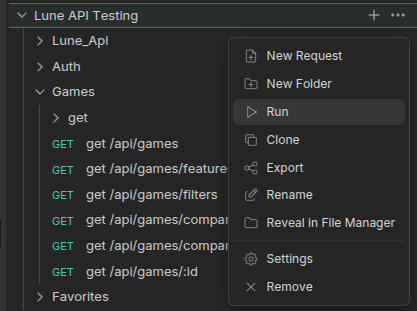
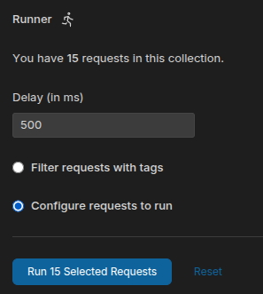

# Terranova

Lune: ASP.NET Core backend, SQL Server, Angular frontend.

## Run with Docker

Requirements: Docker Engine and the Docker Compose plugin. Nothing else needs to be installed locally.

To run only the frontend and mock API, use:

```bash
docker compose up --build mock-api frontend
```

| Service | URL | Notes |
|---|---|---|
| Frontend (Angular) | [http://localhost:8080](http://localhost:8080) | `/api` is proxied to the mock API |
| Mock API (ASP.NET Core) | [http://localhost:4001](http://localhost:4001) | In-memory, resets on restart |
| Backend (Asp.net Core) | [http://localhost:3001](http://localhost:3001) | Persistant data |

Press `Ctrl+C` to stop, or run `docker compose down`.

### Mock API

[mock-api/](./mock-api) implements everything in [docs/API.md](./docs/API.md) so the frontend can be built without the real backend. It is organised by module (`Auth`, `Games`, `Favorites`, `Shared`), and the game catalog lives in `mock-api/Data/games.json`.

- Demo login: `demo@example.com` / `Passw0rd!` (or register a new account).
- Add `?mock503=1` to a games request, or to `PUT /api/favorites/{id}`, to simulate the game provider being unavailable.
- Data is held in memory, so favorites and new accounts reset when the container restarts.

### Real backend

The SQL Server and ASP.NET Core backend are regular Compose services; no profile is needed. The backend is available at [http://localhost:3001](http://localhost:3001). To run the full stack against it, copy `.env.example` to `.env` and set `SA_PASSWORD`, `JWT_SECRET` and `RAWG_API_KEY`. Then start Compose with the frontend pointed at the backend:

```bash
API_URL=http://backend:3001 docker compose up --build
```

The mock API remains available on port 4001. `API_URL` changes the frontend's `/api` proxy target; without it, the frontend continues to use the mock. The backend is a modular ASP.NET Core API in [backend/src/](./backend/src) (`Lune.Api`, `Auth`, `Games`, `Favorites`, `Shared`). Each module owns its own database schema and applies its EF migrations at startup. All routes live under `/api` (for example `/api/favorites`), and auth is an HttpOnly `Lune_auth` cookie, so log in first (`POST /api/auth/login`) before calling the favorites endpoints. See [docs/API.md](./docs/API.md) and [docs/DATABASE.md](./docs/DATABASE.md).

## Without Docker

Mock API (.NET 10 SDK):

```bash
cd mock-api && dotnet run --urls http://localhost:4001
```

Frontend (Node.js 22):

```bash
cd frontend && npm install && npm start
```

## Dev Dependencies

Backend development requires Microsoft's dotnet SDK

Install with:
```
sudo apt-get update && sudo apt-get install -y dotnet-sdk-10.0
```
Only one external package is used in this project (Scalar for API documentation and testing)

Install (in Lune.Api project directory) with:

```
dotnet add package Scalar.AspNetCore
```

## Testing

For API testing, we use [Bruno](https://docs.usebruno.com/) which works with an opensource test collection format `opencollection.yaml`. These collections that can be imported to other testing suites such as Postman.

The test collection can be found at `/testing/endpoint-testing/lune-api-testing`. This collection can be opened with Bruno deskop,
or can be accessed from within the VSCode IDE using the Bruno Extension `id: bruno-api-client.bruno`

The entire endpoint collection can be run from the Bruno collections sidebar.

1. Click `...` next to collection name and select "Run"
2. Specify the order of requests (note some might impact the outcome of others, ex. don't test 'logout' before accessing auth protected endpoints).
3. Run the requests
4. Explore the responses.




### Updating tests for new endpoints

To retrieve an up to date openapi.json, run the following command from project root while the project is running:
`curl -s http://localhost:3001/openapi/v1.json -o docs/openapi.json`
This will save a copy to the /docs directory.

To pre-populate a reference Bruno collection based on the openapi.json:
(Requires `node > 20` and `npm install-g usebruno/cli`)

Run ```bru import openapi -s docs/openapi.json -o testing/endpoint-testing/lune-reference-api -n "Lune Reference API" --collection-format=opencollection```

Now, you can copy over any new endpoints to the `lune-api-testing` collection and begin to build out new tests.
