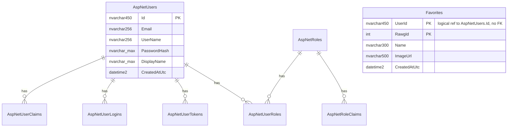

# Lune database schema

One SQL Server database (`Lune`). Each backend module owns its own **schema** and its own EF Core `DbContext` and migrations, which are applied automatically on startup. Each schema has its own `__EFMigrationsHistory` table.

| Module | SQL schema | Tables |
|---|---|---|
| Auth | `auth` | ASP.NET Identity tables |
| Favorites | `favorites` | `Favorites` |
| Games | none | Nothing stored. Data comes from the RAWG API, cached in memory. |

Game data is not in the database. That is why `Favorites` keeps a snapshot of the game's name and image.

## ER diagram



`favorites.Favorites.UserId` holds the same value as `auth.AspNetUsers.Id`, but there is **no foreign key**. This is deliberate: modules don't couple through the database, so a module can later move to its own database. Consequences:

- Deleting a user does not delete their favorites (there is no delete-user feature yet).
- The API enforces ownership, because the user id always comes from the auth token.

## Schema `auth` (ASP.NET Identity)

Standard Identity tables, plus two custom columns on `AspNetUsers`.

### `auth.AspNetUsers`

| Column | Type | Null | Notes |
|---|---|:-:|---|
| `Id` | nvarchar(450) | No | **PK**, GUID string |
| `DisplayName` | nvarchar(max) | Yes | **Custom** |
| `CreatedAtUtc` | datetime2 | No | **Custom**, set at registration |
| `UserName` | nvarchar(256) | Yes | Same as `Email` at registration |
| `NormalizedUserName` | nvarchar(256) | Yes | Uppercased. **Unique index** |
| `Email` | nvarchar(256) | Yes | |
| `NormalizedEmail` | nvarchar(256) | Yes | Uppercased. Index |
| `EmailConfirmed` | bit | No | Always false (no confirmation flow) |
| `PasswordHash` | nvarchar(max) | Yes | Salted PBKDF2 hash. Never the password. |
| `SecurityStamp` | nvarchar(max) | Yes | |
| `ConcurrencyStamp` | nvarchar(max) | Yes | |
| `PhoneNumber` | nvarchar(max) | Yes | Unused |
| `PhoneNumberConfirmed` | bit | No | Unused |
| `TwoFactorEnabled` | bit | No | Unused |
| `LockoutEnd` | datetimeoffset | Yes | Set after repeated failed logins |
| `LockoutEnabled` | bit | No | |
| `AccessFailedCount` | int | No | Failed logins since the last success |

Indexes: `PK_AspNetUsers (Id)`, `UserNameIndex (NormalizedUserName) UNIQUE WHERE NOT NULL`, `EmailIndex (NormalizedEmail)`.

### Other Identity tables (unused so far, created by the migration)

| Table | Columns | PK | FKs |
|---|---|---|---|
| `AspNetRoles` | `Id` nvarchar(450), `Name` nvarchar(256)?, `NormalizedName` nvarchar(256)?, `ConcurrencyStamp` nvarchar(max)? | `Id` | none. Unique index `RoleNameIndex (NormalizedName)` |
| `AspNetUserRoles` | `UserId` nvarchar(450), `RoleId` nvarchar(450) | (`UserId`, `RoleId`) | `UserId` -> AspNetUsers, `RoleId` -> AspNetRoles (both cascade) |
| `AspNetUserClaims` | `Id` int identity, `UserId` nvarchar(450), `ClaimType`?, `ClaimValue`? nvarchar(max) | `Id` | `UserId` -> AspNetUsers (cascade) |
| `AspNetRoleClaims` | `Id` int identity, `RoleId` nvarchar(450), `ClaimType`?, `ClaimValue`? nvarchar(max) | `Id` | `RoleId` -> AspNetRoles (cascade) |
| `AspNetUserLogins` | `LoginProvider` nvarchar(450), `ProviderKey` nvarchar(450), `ProviderDisplayName`? nvarchar(max), `UserId` nvarchar(450) | (`LoginProvider`, `ProviderKey`) | `UserId` -> AspNetUsers (cascade). Reserved for GitHub OAuth. |
| `AspNetUserTokens` | `UserId` nvarchar(450), `LoginProvider` nvarchar(450), `Name` nvarchar(450), `Value`? nvarchar(max) | (`UserId`, `LoginProvider`, `Name`) | `UserId` -> AspNetUsers (cascade) |

`?` means nullable. Each FK column also has a non-unique index named `IX_<Table>_<Column>`.

## Schema `favorites`

### `favorites.Favorites`

| Column | Type | Null | Notes |
|---|---|:-:|---|
| `UserId` | nvarchar(450) | No | **PK part 1.** The `auth.AspNetUsers.Id` of the owner. No FK. |
| `RawgId` | int | No | **PK part 2.** RAWG game id. |
| `Name` | nvarchar(300) | No | Game name snapshot (truncated to 300) |
| `ImageUrl` | nvarchar(500) | Yes | Cover image snapshot. `null` if the URL is over 500 chars. |
| `CreatedAtUtc` | datetime2 | No | When it was favorited. The list is sorted by this, newest first. |

- PK `(UserId, RawgId)`: a user can favorite a game only once. This is also how duplicate or racing inserts are handled.
- Index `IX_Favorites_RawgId (RawgId)`, non-unique.
- Rule enforced in code, not in the DB: at most **1000** rows per user.

## DDL reference (SQL Server)

```sql
CREATE SCHEMA auth;
GO
CREATE SCHEMA favorites;
GO

CREATE TABLE auth.AspNetUsers (
    Id                   nvarchar(450)  NOT NULL CONSTRAINT PK_AspNetUsers PRIMARY KEY,
    DisplayName          nvarchar(max)  NULL,
    CreatedAtUtc         datetime2      NOT NULL,
    UserName             nvarchar(256)  NULL,
    NormalizedUserName   nvarchar(256)  NULL,
    Email                nvarchar(256)  NULL,
    NormalizedEmail      nvarchar(256)  NULL,
    EmailConfirmed       bit            NOT NULL,
    PasswordHash         nvarchar(max)  NULL,
    SecurityStamp        nvarchar(max)  NULL,
    ConcurrencyStamp     nvarchar(max)  NULL,
    PhoneNumber          nvarchar(max)  NULL,
    PhoneNumberConfirmed bit            NOT NULL,
    TwoFactorEnabled     bit            NOT NULL,
    LockoutEnd           datetimeoffset NULL,
    LockoutEnabled       bit            NOT NULL,
    AccessFailedCount    int            NOT NULL
);
CREATE UNIQUE INDEX UserNameIndex ON auth.AspNetUsers (NormalizedUserName) WHERE NormalizedUserName IS NOT NULL;
CREATE INDEX EmailIndex ON auth.AspNetUsers (NormalizedEmail);

CREATE TABLE favorites.Favorites (
    UserId       nvarchar(450) NOT NULL,
    RawgId       int           NOT NULL,
    Name         nvarchar(300) NOT NULL,
    ImageUrl     nvarchar(500) NULL,
    CreatedAtUtc datetime2     NOT NULL,
    CONSTRAINT PK_Favorites PRIMARY KEY (UserId, RawgId)
);
CREATE INDEX IX_Favorites_RawgId ON favorites.Favorites (RawgId);
```

The remaining Identity tables are in `backend/src/Lune.Auth/Data/Migrations/20261023092055_InitialIdentity.cs`. A mock doesn't need them.

## Mock data model (simplified)

A mock only needs two collections:

```ts
interface UserRow {
  id: string;            // GUID
  email: string;         // unique, case-insensitive
  displayName: string | null;
  passwordHash: string;  // a plain string is fine in a mock
  createdAtUtc: string;
  accessFailedCount: number;
  lockoutEnd: string | null;
}

interface FavoriteRow {
  userId: string;        // key part 1
  rawgId: number;        // key part 2, unique together with userId
  name: string;
  imageUrl: string | null;
  createdAtUtc: string;
}
```

Notes:
- Enforce the unique email, case-insensitively. `NormalizedEmail` is just the uppercased email.
- Enforce the unique `(userId, rawgId)` pair.
- Games are a static JSON file. They are **not** in the database.
- The API returns `FavoriteRow` as `{ id: rawgId, name, imageUrl, addedAtUtc: createdAtUtc }`. The `userId` is never returned.
